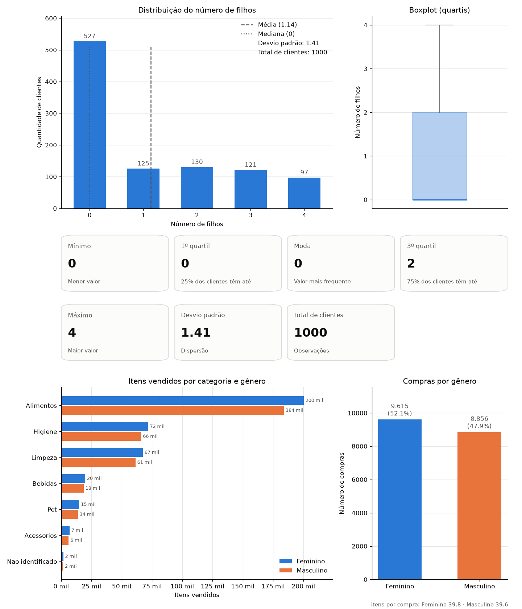

# SCTEC_MiniProjetoAnaliseDados

Mini projeto de análise de dados de uma base de varejo com **pandas** e **matplotlib**.

O script `projeto.py` carrega a base, limpa os dados, calcula estatísticas descritivas, faz agrupamentos, imprime as conclusões e gera um dashboard em imagem (`dashboard.png`).



## Requisitos

- **Python 3.11 ou superior**
- Bibliotecas:

| Biblioteca | Para que é usada |
|---|---|
| [pandas](https://pandas.pydata.org/) | Leitura do CSV, limpeza, estatísticas e agrupamentos (`groupby` e `pivot_table`) |
| [matplotlib](https://matplotlib.org/) | Gráficos e cartões do dashboard |

O módulo `zipfile`, usado para descompactar a base, já vem com o Python.

## Instalação

1. Clone o repositório e entre na pasta:

   ```bash
   git clone <url-do-repositorio>
   cd SCTEC_MiniProjetoAnaliseDados
   ```

2. (Opcional, mas recomendado) Crie e ative um ambiente virtual:

   ```bash
   python -m venv .venv
   ```

   - Windows (PowerShell): `.venv\Scripts\Activate.ps1`
   - Linux/macOS: `source .venv/bin/activate`

3. Instale as bibliotecas:

   ```bash
   pip install pandas matplotlib
   ```

## Como usar

Na pasta do projeto, execute:

```bash
python projeto.py
```

A base vem compactada em `BaseVarejo.csv.zip`. Se o arquivo `Base Varejo.csv` ainda não existir, o script descompacta o zip automaticamente na primeira execução. O CSV descompactado está no `.gitignore`.

Ao final, abre uma janela com o dashboard e a imagem é salva como `dashboard.png`. O script só termina quando a janela é fechada.

## O que o script faz

O fluxo está no bloco `if __name__ == "__main__":` e chama as funções nesta ordem:

| Função | O que faz |
|---|---|
| `VerificarArquivoBase()` | Carrega `Base Varejo.csv` (separador `;`), descompactando o zip se precisar |
| `LimparDados(df)` | Limpeza mínima em 3 etapas: nulos, duplicatas e tipos de dados (detalhes abaixo) |
| `MostrarInfo(df)` | Mostra número de registros, colunas, tipos de dados, primeiras linhas e `describe()` |
| `EstatisticasFilhos(df)` | Estatísticas do número de filhos por cliente: contagem, média, mediana, desvio padrão, moda, mínimo, quartis e máximo |
| `PadroesAgrupamento(df)` | Compras, itens e clientes por gênero (`groupby`) e itens vendidos por categoria e gênero (`pivot_table`) |
| `Conclusoes(...)` | Imprime os principais insights e os problemas que ainda existem na base |
| `GerarDashboard(...)` | Monta o dashboard e salva em `dashboard.png` |

### Limpeza dos dados

1. **Nulos:** remove as colunas vazias criadas pelo `;;;;` no fim das linhas. Os valores `#N/D` (erro de PROCV do Excel) em `PR_CAT` e `PR_NOME` são preenchidos com `NAO IDENTIFICADO`, em vez de removidos, para não perder os dados de compra e cliente dessas linhas.
2. **Duplicatas:** remove linhas idênticas em todas as colunas.
3. **Tipos:** converte `DATA` para data (`dd/mm/aaaa`) e as colunas de texto para `category`.

### Dashboard

- Distribuição do número de filhos, com média, mediana, desvio padrão e total de clientes
- Boxplot com os quartis
- Cartões com mínimo, quartis, moda, máximo, desvio padrão e total de clientes
- Itens vendidos por categoria e gênero
- Compras por gênero, com percentual e itens por compra

## Colunas da base

| Coluna | Descrição |
|---|---|
| `DATA` | Data da compra |
| `CO_ID` | Código da compra |
| `CL_ID` | Código do cliente |
| `CL_GENERO` | Gênero do cliente (`F` ou `M`) |
| `CL_EC` | Código de 1 a 5, provavelmente estado civil |
| `CL_FHL` | Número de filhos do cliente (0 a 4) |
| `CL_SEG` | Segmento do cliente (`A`, `B` ou `C`) |
| `PR_ID` | Código do produto |
| `PR_CAT` | Categoria do produto |
| `PR_NOME` | Nome do produto |

A base não tem dicionário de dados. Os significados de `CL_EC`, `CL_FHL` e `CL_SEG` foram deduzidos pelos nomes e valores. Também não há colunas de valor nem de quantidade: cada linha é contada como um item vendido e cada `CO_ID` como uma compra.

## Dica: acentos no terminal do Windows

Se os acentos aparecerem trocados por símbolos estranhos no terminal, rode antes:

```bash
chcp 65001
```
